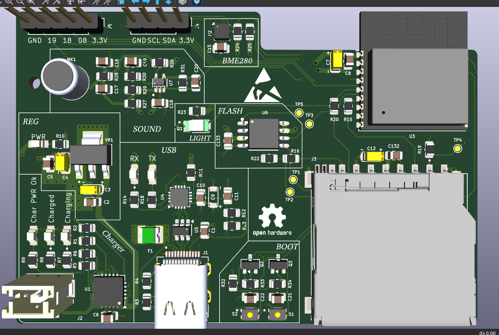
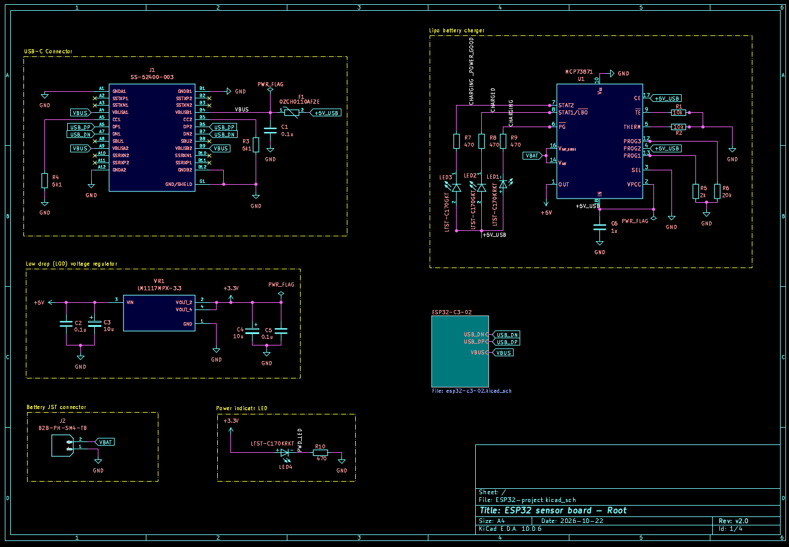

# ESP32-C3 Sensor Board

A compact, battery-powered IoT sensor board built around the **ESP32-C3-WROOM-02** module. It combines environment, light and sound sensing with USB-C charging, a built-in USB-to-UART bridge (auto-program), external flash and a microSD card slot.

Designed in **KiCad 10.0.6** as a 4-layer PCB.



---

## Features

- **MCU:** ESP32-C3-WROOM-02 (Wi-Fi + Bluetooth LE, RISC-V)
- **Power:** USB-C input with fuse, Li-Po charging (MCP73871), 3.3 V LDO (LM1117-3.3)
- **USB-UART:** CP2102N (QFN-20) with USBLC6-2SC6 ESD protection
- **Auto-program:** DTR/RTS transistor circuit (2x BC817) for automatic BOOT/EN control, no manual button press needed to flash
- **Sensors:**
  - BME280: temperature, humidity, pressure (I2C)
  - TEMT6000: ambient light sensor
  - CMC-5042PF-AC electret microphone with MAX4466 amplifier
- **Storage:** W25Q32JV 32 Mbit SPI flash and microSD card slot
- **User interface:** BOOT and RESET buttons, I2C OLED header, GPIO breakout header
- **Indicators:** power, charging, charged and power-good LEDs, plus UART status LEDs
- **Test points:** TP1 to TP5 for SPI signals (MOSI, MISO, SCLK, CS, CS_CD)
- **PCB:** 4 layers, antenna keep-out zone, fully routed (0 unrouted nets)

---

## Block Overview

| Block | Main parts |
|---|---|
| USB-C input | J1 (SS-52400-003), F1 fuse, 5.1k CC resistors |
| Battery charger | U1 MCP73871, J2 JST-PH battery connector |
| Voltage regulator | VR1 LM1117MPX-3.3 |
| MCU | U3 ESP32-C3-WROOM-02 |
| USB to UART | U4 CP2102N, U5 USBLC6-2SC6 |
| Flash memory | U6 W25Q32JVSSIQ |
| SD card | J3 GSD090012SEU |
| Environment sensor | U2 BME280 |
| Light sensor | Q1 TEMT6000X01 |
| Microphone | MK1 CMC-5042PF-AC + U7 MAX4466EXK |
| Boot / reset | S1 (BOOT), S2 (RESET), Q2/Q3 BC817 |
| Headers | J4 (OLED, 4-pin I2C), J5 (breakout: GPIO8, GPIO18, GPIO19, 3.3 V, GND) |

---

## Components List

Values are taken from the schematic.

### Sheet 1: Power (root)

| Ref | Component | Value / Part number |
|---|---|---|
| J1 | USB-C connector | SS-52400-003 |
| F1 | Fuse | 0ZCH0110AF2E |
| J2 | Battery connector (JST-PH) | B2B-PH-SM4-TB |
| U1 | Li-Po charger | MCP73871 |
| VR1 | 3.3 V LDO regulator | LM1117MPX-3.3 |
| LED1, LED4 | Red LEDs | LTST-C170KRKT |
| LED2, LED3 | Green LEDs | LTST-C170GKT |
| C1, C2, C5 | Capacitors | 0.1 uF |
| C3, C4 | Capacitors | 10 uF |
| C6 | Capacitor | 1 uF |
| R1, R2 | Resistors | 10 k |
| R3, R4 | Resistors (USB-C CC) | 5.1 k |
| R5 | Resistor | 2 k |
| R6 | Resistor | 20 k |
| R7, R8, R9, R10 | Resistors (LED) | 470 |

### Sheet 2: ESP32-C3, USB-UART, flash, SD card

| Ref | Component | Value / Part number |
|---|---|---|
| U3 | Wi-Fi + BLE module | ESP32-C3-WROOM-02 |
| U4 | USB-to-UART bridge | CP2102N-Axx-xQFN20 |
| U5 | USB ESD protection | USBLC6-2SC6 |
| U6 | SPI flash (32 Mbit) | W25Q32JVSSIQ |
| J3 | microSD card slot | GSD090012SEU |
| TP1 to TP5 | Test points | MOSI, MISO, SCLK, CS, CS_CD |
| LED5 | Red LED | LTST-C170KRKT |
| LED6 | Green LED | LTST-C170GKT |
| C7, C9, C12 | Capacitors | 10 uF |
| C8, C10, C132, C133 | Capacitors | 0.1 uF |
| C11 | Capacitor | 1 uF |
| R11 | Resistor | 1 k |
| R12 | Resistor | 22.1 k |
| R13 | Resistor | 47.5 k |
| R14, R18 | Resistors (LED) | 470 |
| R15, R16, R20, R22 | Resistors | 50 |
| R19 | Resistor | 10 k |

### Sheet 3: Sensors

| Ref | Component | Value / Part number |
|---|---|---|
| U2 | Temperature, humidity, pressure sensor | BME280 |
| Q1 | Ambient light sensor | TEMT6000X01 |
| U7 | Microphone amplifier | MAX4466EXK |
| MK1 | Electret microphone | CMC-5042PF-AC |
| C15, C16, C18, C20 | Capacitors | 0.1 uF |
| C17 | Capacitor | 10 uF |
| C19 | Capacitor | 1 uF |
| R23, R30 | Resistors | 10 k |
| R24, R25 | Resistors (I2C pull-up) | 4.7 k |
| R26, R28 | Resistors | 2 k |
| R27, R29 | Resistors | 1 M |
| R31 | Resistor | 100 k |

### Sheet 4: User interface

| Ref | Component | Value / Part number |
|---|---|---|
| J4 | OLED display header (I2C) | Conn_01x04_Pin |
| J5 | GPIO breakout header | Conn_01x05_Pin |
| S1 | BOOT button | Tactile switch |
| S2 | RESET button | Tactile switch |
| Q2, Q3 | Auto-program transistors | BC817 |
| R32, R33, R34 | Resistors | 10 k |
| C21 | Capacitor | 0.1 uF |
| C22 | Capacitor | 1 uF |

---

## Schematic Structure

The design is hierarchical (4 sheets):

| Sheet | File | Content |
|---|---|---|
| 1/4 | `ESP32-project.kicad_sch` | Root: power input, charger, regulator, LEDs |
| 2/4 | `esp32-c3-02.kicad_sch` | ESP32-C3, USB-UART, flash, SD card, test points |
| 3/4 | `sensors.kicad_sch` | BME280, photo sensor, microphone and amplifier |
| 4/4 | `user_intertface.kicad_sch` | OLED header, BOOT/RESET buttons, auto-program, breakout |

Full schematic PDF: [`ESP32-project.pdf`](ESP32-project/ESP32-project.pdf)

---

## Power Path

```
USB-C (5 V) -> Fuse -> MCP73871 -> Li-Po battery (JST-PH)
                          |
                          +-> +5V rail -> LM1117-3.3 -> +3.3 V (ESP32, sensors, flash, SD)
```

The MCP73871 supports power-path management, so the board runs from USB while the battery charges.

---

## Programming

1. Connect the board to your PC with a USB-C cable.
2. The CP2102N appears as a serial port.
3. Flash using Arduino IDE, ESP-IDF or PlatformIO. The DTR/RTS circuit puts the ESP32-C3 into boot mode automatically.
4. For manual boot mode: hold **BOOT**, press **RESET**, release both.

Reference: [ESP32 boot mode selection](https://docs.espressif.com/projects/esptool/en/latest/esp32c3/advanced-topics/boot-mode-selection.html)

---

## PCB Details

| Item | Value |
|---|---|
| EDA tool | KiCad 10.0.6 |
| Layers | 4 (F.Cu, In1.Cu, In2.Cu, B.Cu) |
| Pads | 330 |
| Vias | 145 |
| Nets | 76 |
| Unrouted | 0 |
| Antenna | Keep-out zone at the board edge, no copper or components under the ESP32 antenna |

Silkscreen includes the Open Source Hardware logo, ESD warning symbol and section labels (REG, USB, SOUND, LIGHT, FLASH, BOOT).

---

## PCB Layers

### Copper layers (4-layer stackup)

| Layer | Name | Purpose |
|---|---|---|
| 1 | **F.Cu** (top) | Components and signal routing (red) |
| 2 | **In1.Cu** | Internal layer: copper plane (zone fill) with some routing |
| 3 | **In2.Cu** | Internal layer: copper plane (zone fill) with some routing |
| 4 | **B.Cu** (bottom) | Signal routing (blue) |

### Other layers used

| Layer | Purpose |
|---|---|
| F.Silkscreen / B.Silkscreen | Reference designators, section labels, logos (Open Hardware, ESD, KiCad logo on back) |
| F.Mask / B.Mask | Solder mask openings for pads |
| F.Paste / B.Paste | Solder paste stencil for SMD pads |
| F.Courtyard / B.Courtyard | Component keep-out area for placement |
| F.Fab / B.Fab | Fabrication outlines of parts |
| Edge.Cuts | Board outline |
| User.Drawings / User.Comments | Antenna keep-out zone and notes |

---

## Board Preview

| 3D view (top) | PCB layout |
|:---:|:---:|
|  |  |

- **Board:** 4-layer, 330 pads, 145 vias, 783 track segments, 76 nets, 0 unrouted
- **Antenna:** 5 mm keep-out zone at the top right, no copper or parts
- **Placement:** ESP32-C3 module top right, microSD slot bottom right, USB-C bottom centre, JST-PH battery connector bottom left, sensors and microphone on the left

## PCB Layer Views

| Component layout |
|:---:|
|  |

- **F.Cu / B.Cu:** red tracks on top, blue tracks on bottom; the thick red track carries power from the charger towards the regulator
- **In1.Cu:** copper pour (green) with a few tracks, no pour under the antenna
- **In2.Cu:** copper pour (orange) with some routing, cutout around the USB-C connector area
- **Silkscreen:** reference designators, section labels (REG, SOUND, LIGHT, FLASH, USB, BOOT), header pin labels, ESD symbol, Open Source Hardware logo; the mirrored KiCad logo is on the back
- **Component layout:** pads in purple and courtyards in magenta with tracks hidden

## Schematic

The schematic has four sections:

1. **Root:** USB-C input, fuse, MCP73871 Li-Po charger, LM1117-3.3 regulator, status LEDs, JST-PH battery connector
2. **ESP32-C3:** ESP32-C3-WROOM-02, CP2102N USB-UART, USBLC6-2SC6 ESD protection, W25Q32JV flash, microSD slot, test points
3. **Sensors:** BME280, TEMT6000 light sensor, electret microphone with MAX4466 amplifier
4. **User interface:** I2C OLED header, GPIO breakout header, BOOT and RESET buttons, DTR/RTS auto-program transistors

| Sheet 1: Root | Sheet 2: ESP32-C3 |
|:---:|:---:|
|  |  |

| Sheet 3: Sensors | Sheet 4: User interface |
|:---:|:---:|
|  |  |

---

## Repository Structure

```
ESP32-project
├── ESP32-project.kicad_pro
├── ESP32-project.kicad_sch        # root sheet
├── esp32-c3-02.kicad_sch
├── sensors.kicad_sch
├── user_intertface.kicad_sch
├── ESP32-project.kicad_pcb
├── ESP32-project.pdf              # schematic
├── image/                       
├── README.md
└── Project_library
    ├── 3D-model/                   # STEP models
    ├── footprint.pretty/           # Footprint files
    └── symbol/                     # Symbol files
```

> Adjust the file names to match your repository.

---

## Getting Started

1. Install [KiCad 10](https://www.kicad.org/download/).
2. Clone the repository:
   ```bash
   git clone https://github.com/pravinsharma15k-ops/<repo-name>.git
   ```
3. Open `ESP32-project.kicad_pro`.
4. Make sure the custom symbol, footprint and 3D model library paths are set (Preferences > Manage Symbol/Footprint Libraries, and Configure Paths for 3D models).

---

## Status

- [x] Schematic complete (v2.0)
- [x] PCB layout and routing complete
- [x] 3D models check for all parts
- [ ] Prototype fabrication
- [ ] Firmware and testing


---

## Author

**Pravin Kumar Sharma**
B.Tech ECE, RIT Roorkee

- GitHub: [pravinsharma15k-ops](https://github.com/pravinsharma15k-ops)
- LinkedIn: [pravin-sharma-ece](https://linkedin.com/in/pravin-sharma-ece)